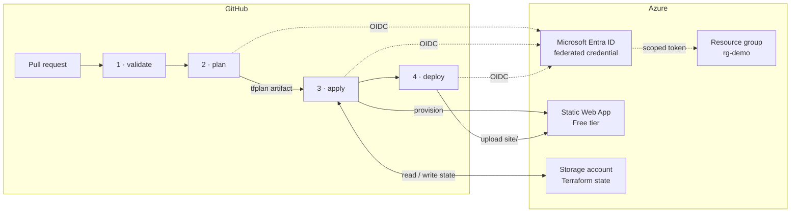

# Architecture

## Two stacks, on purpose

| Stack       | State        | Lifetime      | Purpose                                                        |
| ----------- | ------------ | ------------- | -------------------------------------------------------------- |
| `bootstrap/` | local        | forever       | Remote state account, app resource group, Entra app + federated credentials, RBAC. |
| `infra/`     | Azure Storage | per deploy    | The actual application infrastructure.                          |

`bootstrap` cannot use remote state because it creates the remote state. It is
run once, by a human, with your own credentials. Everything after that is
machine-driven.

## Authentication flow

1. The workflow declares `permissions: id-token: write`.
2. `azure/login` asks GitHub's token service for an OIDC token.
3. The token contains a **subject** such as
   `repo:you/repo:ref:refs/heads/main` or
   `repo:you/repo:environment:production`.
4. Entra ID compares issuer + subject + audience against the federated
   credentials created by `bootstrap/`. If they match, it returns a short-lived
   access token.
5. The token is valid for about an hour and is scoped to the role assignments
   on the service principal.

There is no client secret anywhere: not in the repo, not in GitHub secrets, not
in Terraform state.

## Decisions and trade-offs

**Why apply a saved plan?**
`terraform plan -out=tfplan` in one job, `terraform apply tfplan` in the next.
The diff a reviewer approved is the diff that runs. Re-planning inside the apply
job would allow drift or a changed variable to slip through.

**Why inject the backend config?**
`backend "azurerm" {}` is intentionally empty. CI passes `-backend-config` from
repository variables; `make init` reads them from `bootstrap` outputs. Nothing
environment-specific is committed, so a second stack is one variable away
(`STATE_KEY=staging.tfstate`).

**Why is the app resource group created by bootstrap?**
So the CI identity can be `Contributor` on exactly one resource group instead of
the whole subscription. The trade-off is that `terraform destroy` does not
delete the resource group — that is deliberate.

**Why the Free SKU?**
It is a real product tier, not a trial: free SSL, global CDN, custom domains and
staging environments for pull requests. It costs $0/month. Switch
`sku_tier = "Standard"` when you need SLA, private endpoints or auth.

**Known caveat: fork pull requests.**
GitHub's `pull_request` OIDC subject does not distinguish a fork from a branch in
the same repository. A public repo that accepts fork PRs should either set
`create_pull_request_credential = false` in `bootstrap/terraform.tfvars` or keep
the job-level guard in `pipeline.yml` that skips the plan job for forks. This
repo does both.

## What I would add next

- `tflint` + `trivy config` (IaC scanning) as required checks.
- A `staging` stack (`STATE_KEY=staging.tfstate`) deployed from a `develop` branch.
- Static Web Apps **preview environments** for every pull request.
- Azure Monitor alerts on 5xx from the Static Web App.
- `terraform test` for the module (1.6+ `.tftest.hcl`).
